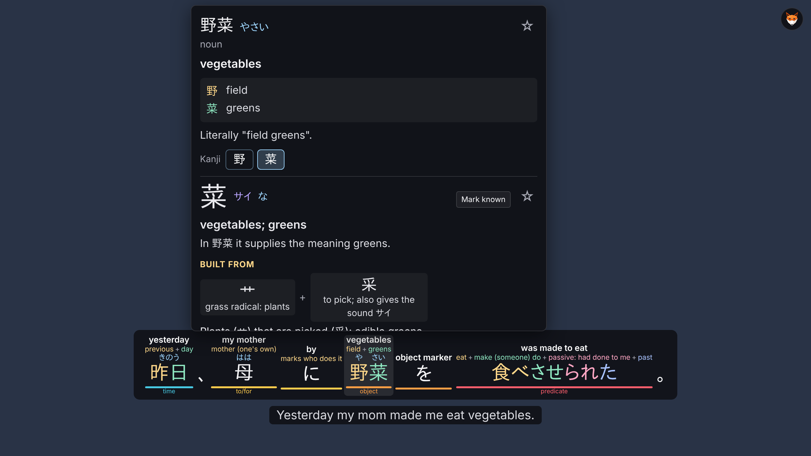
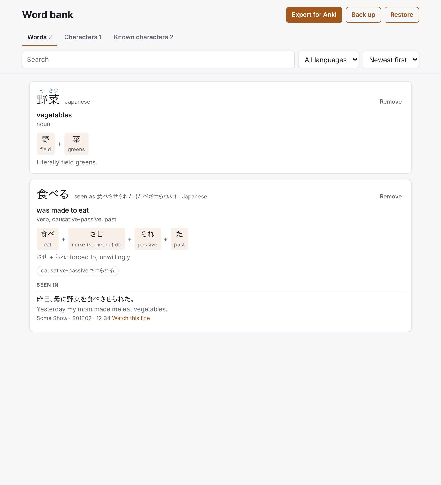
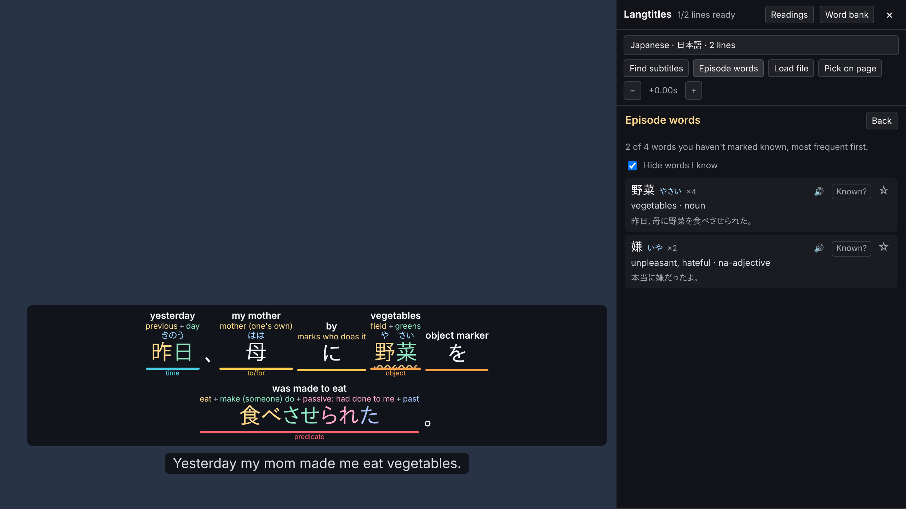
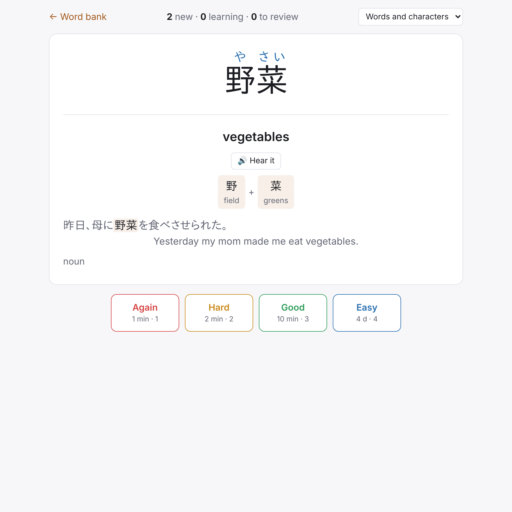
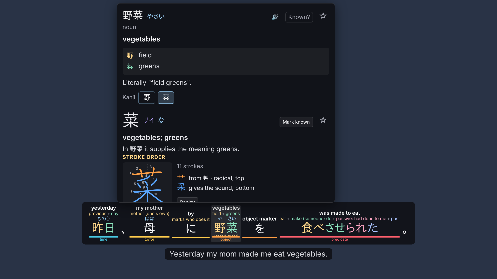
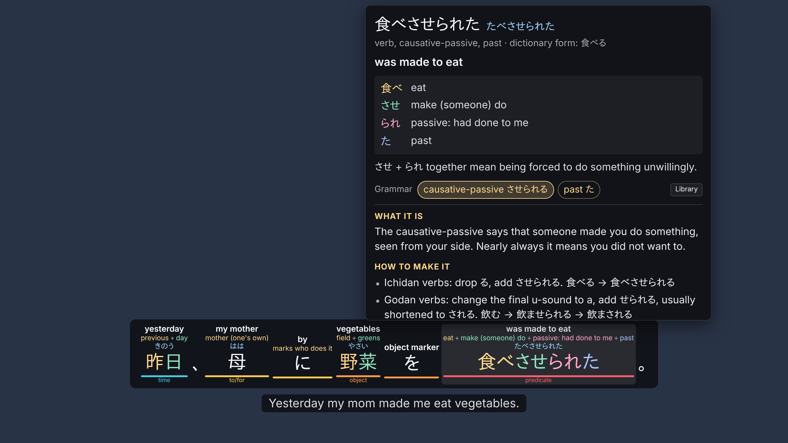
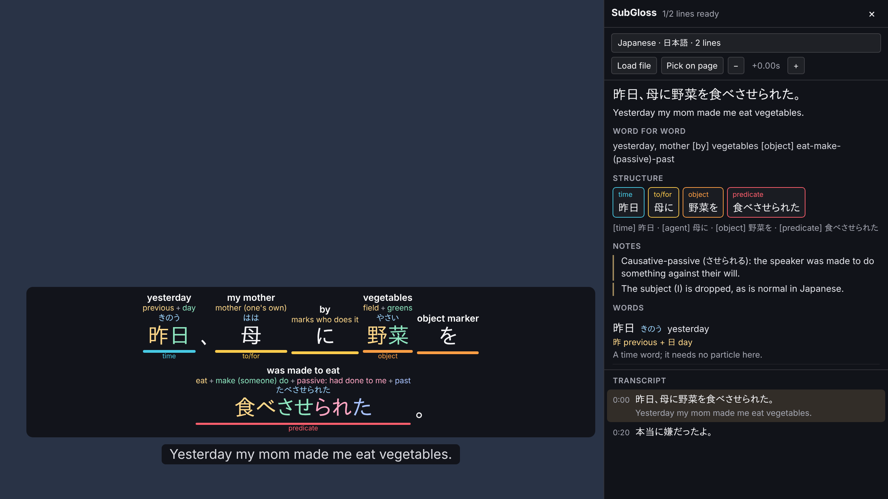
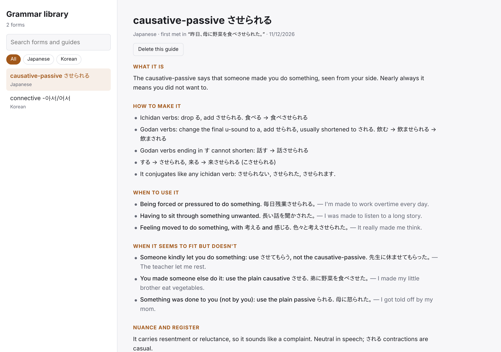
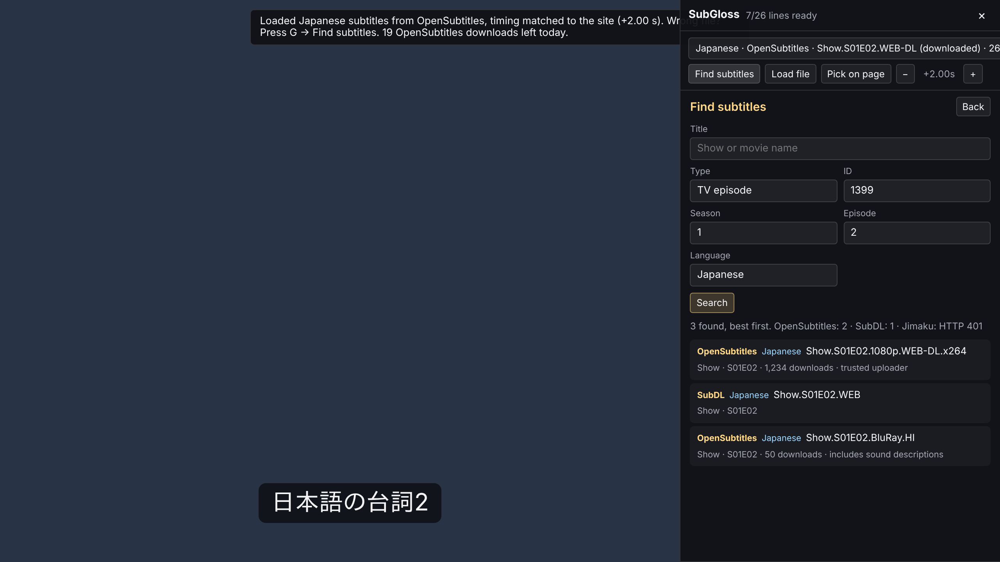

# Langtitles


A Firefox extension that turns the subtitles on any streaming site into a word-by-word breakdown, written by Claude.

Above every word you see what it means in this sentence, the pieces it is built from with what each piece does (`食べ eat + させ make someone do + られ passive + た past`), and its reading. Under each phrase, a coloured bar shows its job in the sentence (topic, object, predicate…). Hovering a word pauses the video and opens a note. A side panel shows the translation, a literal word-for-word rendering, the sentence structure, grammar notes and a clickable transcript.

## Furigana and pinyin

Japanese gets hiragana over each kanji, and Chinese gets pinyin over each character. There is no romanization, for Korean or anything else. Furigana is left off kanji you have marked as known, and pinyin off characters you've marked, unless you turn that off in Options. Press **R** while watching (or **Readings** in the side panel) to switch readings on or off.

## Word bank and characters

- Hover a word and click **☆** to save it, along with the line, its translation, the show and the timestamp. Saving the same word from another line adds that line as another example. The side panel's word list has stars too.
- Every kanji or hanzi in a word appears as a chip in the hover popup. Click one for its own entry: meanings, readings and when each is used, the components it is built from (`艹 grass + 采 pick`), common words that use it, and notes. Entries are written once per character and saved. From there, **☆** saves the character and **Mark known** stops furigana over it.
- **Word bank** (toolbar button, or the panel) lists saved words and characters. You can search them, jump back to the moment a line was said ("Watch this line"), and manage known characters. Paste any text, such as a JLPT kanji list, to mark all its kanji as known at once.
- **Export for Anki** writes a file Anki imports directly (File → Import), including furigana in Anki's format. **Back up** and **Restore** move everything to another browser.




## Studying while you watch

- **New words underlined.** Mark words you know with **Known?** in the hover popup, with **Mark every word known** for a line in the side panel, or by learning them in review. Once 20 words are known in a language, words you don't know yet get a wavy underline.
- **Pause on one new word** (optional, in Options). After a line with exactly one new word, the video pauses with that word shown, since those lines are often the easiest to learn from.
- **Slow replay.** **S** replays the current line at 0.75× (the speed is adjustable), and **L** loops it until you press L again.
- **Pronunciation.** 🔊 in the hover popup, the side panel, the word bank and review reads a word or line aloud. It uses the voices installed on your computer: if one is missing, Langtitles says how to add it.
- **Episode words.** Side panel → **Episode words** lists the words of the whole episode you haven't marked known, most frequent first, with an example line you can jump to. It costs one Claude request per episode, and the list is saved.



## Review

**Review** (toolbar button, word bank, or the panel's Word bank) turns saved words and characters into flashcards with spaced repetition: Again, Hard, Good or Easy schedule the next review (Space shows the answer, keys 1 to 4 grade it). Word cards show the word in the line you met it; the answer adds furigana, meaning, pieces, the translation and audio. Character cards add stroke order. New cards per day can be set in Options. Words and characters you've learned (reviewed every 21 days or longer) count as known automatically, so their furigana and underline go away; this can be turned off.



## Stroke order and components

Every kanji and hanzi entry shows its stroke order, animated and numbered. For Japanese, the data comes from [KanjiVG](https://kanjivg.tagaini.net) (© Ulrich Apel and contributors, CC BY-SA 3.0), which also records each character's components: the diagram colours each component, and lists which one is the radical and which gives the sound. Claude's breakdown sits beside it. For Chinese, stroke order comes from [Make Me a Hanzi](https://github.com/skishore/makemeahanzi) via hanzi-writer-data (Arphic Public License), and the components come from Claude's entry. Stroke data is downloaded the first time a character is opened and then kept.



## Subtitles from subtitle sites

Streaming sites often have no subtitles in the language you are learning. Langtitles can fetch them from **OpenSubtitles**, **SubDL** and **Jimaku** (Japanese anime subtitles) through their official APIs. Each needs a free account; add the keys under **Options → Subtitle sites**.

- **Automatic:** after a few seconds of playback, if the site has no subtitles in your languages, Langtitles works out which episode is playing, picks the best match and loads it. Embedded players such as the ones donkey.to uses put the show's TMDB id, season and episode in their own address, so the episode is exact. On other sites it falls back to the page title, and only fills in the search form.
- **Timing:** downloaded files are often a second or more off. If the site has its own subtitles in any language (often English), Langtitles lines the file up with them automatically, including the 25 / 23.976 fps mismatch. Otherwise use **−** / **+** in the panel (Shift-click for 2-second steps). The timing you set is remembered for that episode.
- **By hand:** press **G** → **Find subtitles** to see every match, best first, and pick another file.
- **Limits:** OpenSubtitles allows 5 downloads a day, or 20 if you add your username and password; SubDL and Jimaku are more generous. Every downloaded file is saved, so rewatching uses no downloads.

## Grammar guides

Every word is tagged with the grammar forms it carries (causative-passive させられる, connective -아서/어서, the 把 construction…). Rest the pointer on a word and Langtitles opens a complete guide to its main form; click any other form to switch. Each guide covers:

- **What it is**, and the idea that ties its uses together
- **How to make it** for every kind of word, irregulars and casual contractions included
- **When to use it**: every common use, with examples
- **When it seems to fit but doesn't**: the situations where you'd reach for it but need a different form, which form, and why, with contrasting examples
- **Nuance and register**, **common mistakes**, and **where you met it**

A guide is written once per form and saved, so the next time that form appears in any word it opens instantly at no cost. The side panel lists the forms in the current line (✓ marks ones you already have). Every guide is collected in the **Grammar library** (toolbar button → Grammar library), which you can search and filter by language. Clearing saved breakdowns in the options keeps your guides.

Subtitles are sent to Claude in batches, ahead of the playhead, so most lines are already analyzed when they appear. Results are saved in Firefox, so rewatching costs nothing.






## Install

You need Firefox 140 or newer and an Anthropic API key from [console.anthropic.com](https://console.anthropic.com).

**Try it (stays until Firefox restarts):**

1. Open `about:debugging#/runtime/this-firefox`.
2. Click **Load Temporary Add-on…** and choose `extension/manifest.json`.
3. Click the Langtitles toolbar button → **Options**, paste your API key, and click **Test key**.

**Keep it installed:** Firefox only installs signed add-ons permanently. Either sign it for yourself (free, not published) on [addons.mozilla.org](https://addons.mozilla.org/developers/) as an "On your own" add-on, using the zip from `npm run package`, or use Firefox Developer Edition or Nightly with `xpinstall.signatures.required` set to `false` in `about:config`.

## Using it

1. Play a video and turn on subtitles in the site's player, in the language you are learning.
2. Langtitles picks them up and starts preparing them. The toolbar button shows how many lines are ready.
3. Hover any word to pause and read more. Move the pointer away and the video resumes.

Keys while a video is playing: **A** / **D** previous / next line, **G** side panel, **H** hide Langtitles subtitles, **R** furigana / pinyin on or off, **S** replay the line slowed down, **L** loop it.

### Where the subtitles come from

Langtitles tries these in order, so it works on sites nobody has written special support for:

1. **Network capture.** Firefox lets the extension read subtitle files (VTT, SRT, ASS, TTML, YouTube json3, and HLS subtitle playlists) as the player downloads them, inside embedded players too. This gives the whole episode up front, which is what makes preparing ahead possible.
2. **The video's text tracks** (`<track>` elements and players that use them).
3. **Reading captions off the page.** Common player caption elements are recognised automatically. On any other player, open the panel (**G**), click **Pick on page**, then click a subtitle on the video; Langtitles remembers that choice for the site. In this mode lines can only be analyzed as they appear, so each new line takes a few seconds.
4. **Load file.** Use a subtitle file from your computer. Use the **−** / **+** buttons to fix timing.

Subtitles that are burned into the video picture cannot be read.

### Sites like donkey.to

donkey.to and similar sites play the video in an embedded player from another domain. Langtitles runs inside embedded players and captures their subtitle requests, so turning subtitles on in that player should be enough. If no subtitles show up, use **Pick on page** or **Load file**. The popup lists every subtitle file it has captured on the tab, which helps when reporting a site that doesn't work.

## Cost

Each line is analyzed once and saved. Grammar guides are longer (roughly 500 to 900 words) and written at medium effort or above, but only once per form. The default model is Claude Opus 5.5 with low thinking effort. Claude Haiku 5.5 is far cheaper, with simpler explanations. Claude Fable 5.2 is the most capable and the most expensive. The options page shows token usage and an estimated spend for each model. "Prepare ahead" (10 minutes by default) controls how far ahead Langtitles analyzes, so skipping through a video doesn't pay for lines you never watch.

## Privacy

The API key is stored in this Firefox profile and used only by the extension's background page; pages and players never see it. Subtitle text, and the word you hover, are sent to the Anthropic API. Nothing else leaves your browser.

## Development

```bash
npm install
```

```bash
npm test
```

```bash
npm run lint
```

```bash
npm run package
```

`npm run build:vendor` rebuilds `extension/vendor/anthropic-sdk.js` from the installed `@anthropic-ai/sdk` package after an upgrade.

| Path | What it does |
|---|---|
| `extension/background/sniffer.js` | Captures subtitle files and HLS subtitle playlists from network responses |
| `extension/background/claude.js` | Claude API calls through the official SDK: structured breakdowns and streamed explanations |
| `extension/background/prompt.js` | Instructions and the JSON schema for the breakdowns |
| `extension/background/main.js` | Request queue, batching, cache lookups, messaging with tabs |
| `extension/content/content.js` | Finds the video, picks a track, prepares lines ahead and draws the overlay and panel |
| `extension/shared/subtitles.js` | Parsers for VTT, SRT, ASS, TTML and json3 |
| `extension/shared/lang.js` | Language guessing used to pick the right track |
| `extension/shared/guide.js` | Renders grammar guides in the overlay and the library |
| `extension/shared/episode.js` | Works out which movie or episode is playing |
| `extension/shared/sync.js` | Lines a downloaded subtitle file up with the site's own subtitles |
| `extension/background/providers.js` | OpenSubtitles, SubDL and Jimaku search and download |
| `extension/background/files.js` | Zip archives and legacy text encodings in downloaded files |
| `extension/grammar/` | The grammar library page |
| `extension/bank/` | The word bank page |
| `extension/review/` | Flashcard review |
| `extension/shared/srs.js` | Review scheduling |
| `extension/shared/strokes.js` | Stroke order parsing and drawing |
| `extension/shared/speech.js` | Pronunciation with the system's voices |
| `extension/shared/ruby.js` | Furigana and pinyin placement, known characters, Anki formatting |
