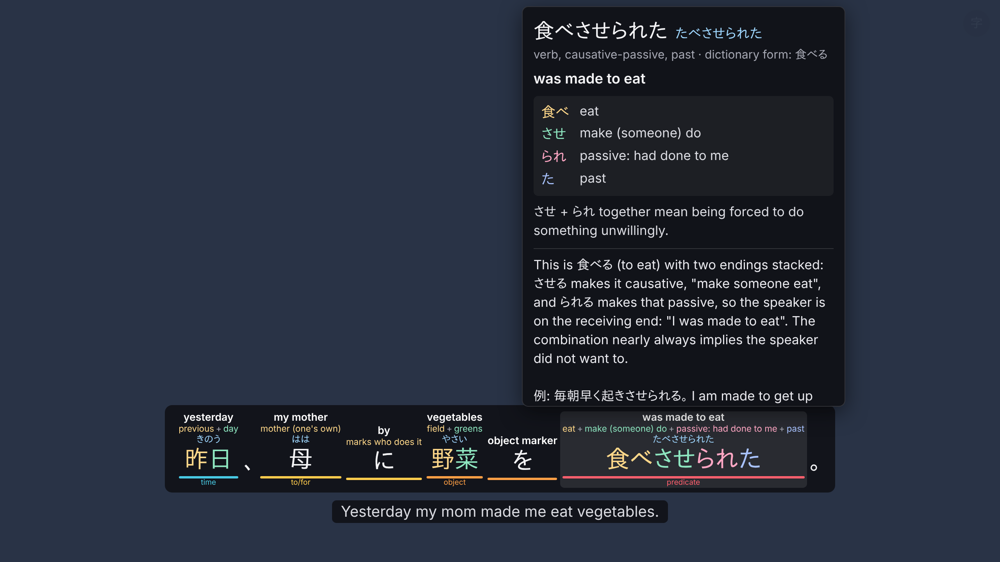
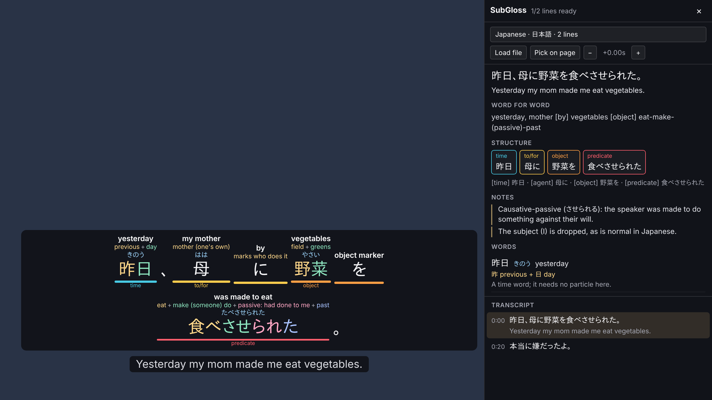

# SubGloss

A Firefox extension that turns the subtitles on any streaming site into a word-by-word breakdown, written by Claude.

Above every word you see what it means in this sentence, the pieces it is built from with what each piece does (`食べ eat + させ make someone do + られ passive + た past`), and its reading. Under each phrase, a coloured bar shows its job in the sentence (topic, object, predicate…). Hovering a word pauses the video and opens a note; resting on it asks Claude for a longer explanation. A side panel shows the translation, a literal word-for-word rendering, the sentence structure, grammar notes and a clickable transcript.

Subtitles are sent to Claude in batches, ahead of the playhead, so most lines are already analyzed when they appear. Results are saved in Firefox, so rewatching costs nothing.




## Install

You need Firefox 140 or newer and an Anthropic API key from [console.anthropic.com](https://console.anthropic.com).

**Try it (stays until Firefox restarts):**

1. Open `about:debugging#/runtime/this-firefox`.
2. Click **Load Temporary Add-on…** and choose `extension/manifest.json`.
3. Click the SubGloss toolbar button → **Options**, paste your API key, and click **Test key**.

**Keep it installed:** Firefox only installs signed add-ons permanently. Either sign it for yourself (free, not published) on [addons.mozilla.org](https://addons.mozilla.org/developers/) as an "On your own" add-on, using the zip from `npm run package`, or use Firefox Developer Edition or Nightly with `xpinstall.signatures.required` set to `false` in `about:config`.

## Using it

1. Play a video and turn on subtitles in the site's player, in the language you are learning.
2. SubGloss picks them up and starts preparing them. The toolbar button shows how many lines are ready.
3. Hover any word to pause and read more. Move the pointer away and the video resumes.

Keys while a video is playing: **A** / **D** previous / next line, **S** replay the line, **G** side panel, **H** hide SubGloss subtitles.

### Where the subtitles come from

SubGloss tries these in order, so it works on sites nobody has written special support for:

1. **Network capture.** Firefox lets the extension read subtitle files (VTT, SRT, ASS, TTML, YouTube json3, and HLS subtitle playlists) as the player downloads them, inside embedded players too. This gives the whole episode up front, which is what makes preparing ahead possible.
2. **The video's text tracks** (`<track>` elements and players that use them).
3. **Reading captions off the page.** Common player caption elements are recognised automatically. On any other player, open the panel (**G**), click **Pick on page**, then click a subtitle on the video; SubGloss remembers that choice for the site. In this mode lines can only be analyzed as they appear, so each new line takes a few seconds.
4. **Load file.** Use a subtitle file from your computer. Use the **−** / **+** buttons to fix timing.

Subtitles that are burned into the video picture cannot be read.

### Sites like donkey.to

donkey.to and similar sites play the video in an embedded player from another domain. SubGloss runs inside embedded players and captures their subtitle requests, so turning subtitles on in that player should be enough. If no subtitles show up, use **Pick on page** or **Load file**. The popup lists every subtitle file it has captured on the tab, which helps when reporting a site that doesn't work.

## Cost

Each line is analyzed once and saved. The default model is Claude Opus 5.5 with low thinking effort. Claude Haiku 5.5 is far cheaper, with simpler explanations. Claude Fable 5.2 is the most capable and the most expensive. The options page shows token usage and an estimated spend for each model. "Prepare ahead" (10 minutes by default) controls how far ahead SubGloss analyzes, so skipping through a video doesn't pay for lines you never watch.

## Privacy

The API key is stored in this Firefox profile and used only by the extension's background page; pages and players never see it. Subtitle text, and the word you hover, are sent to the Anthropic API. Nothing else leaves your browser.

## Development

```bash
npm install
```

```bash
npm test
```

```bash
npm run lint
```

```bash
npm run package
```

`npm run build:vendor` rebuilds `extension/vendor/anthropic-sdk.js` from the installed `@anthropic-ai/sdk` package after an upgrade.

| Path | What it does |
|---|---|
| `extension/background/sniffer.js` | Captures subtitle files and HLS subtitle playlists from network responses |
| `extension/background/claude.js` | Claude API calls through the official SDK: structured breakdowns and streamed explanations |
| `extension/background/prompt.js` | Instructions and the JSON schema for the breakdowns |
| `extension/background/main.js` | Request queue, batching, cache lookups, messaging with tabs |
| `extension/content/content.js` | Finds the video, picks a track, prepares lines ahead and draws the overlay and panel |
| `extension/shared/subtitles.js` | Parsers for VTT, SRT, ASS, TTML and json3 |
| `extension/shared/lang.js` | Language guessing used to pick the right track |
